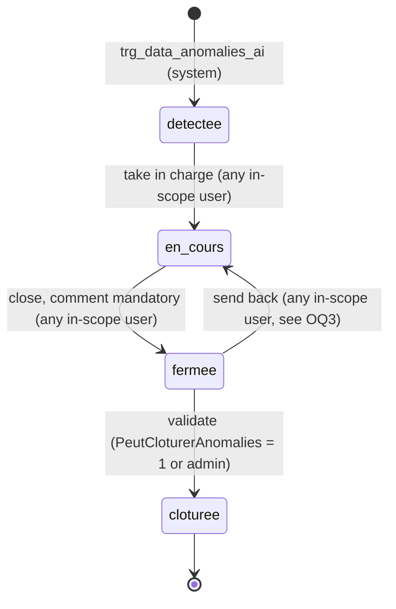

# Feature: Anomaly Workflow Drawer

> Forward-looking product spec, per
> [`engineering/product/FEATURE.md`](../engineering/product/FEATURE.md). One of the three
> dashboard features (with [`IN-PROGRESS-Pulse.md`](IN-PROGRESS-Pulse.md) and
> [`IN-PROGRESS-Trends.md`](IN-PROGRESS-Trends.md)).
>
> Sources:
> - Confluence COC « 2026-11-18 - dashboard » §5 "Volet anomalie" + workflow table, §8.1, §8.3
>   (owner Gaël COQUIO) —
>   https://c-pal.atlassian.net/wiki/spaces/COC/pages/115605505/2026-11-18+-+dashboard
> - Confluence COC « Version 5 — Historisation des anomalies : T_ANOMALIE » —
>   https://c-pal.atlassian.net/wiki/spaces/COC/pages/90308609
> - Owner decisions of 2026-11-19 (Felipe): three separate features, additive work,
>   anomalies are a drawer, no profile-menu work, mainly DB reads. They override the
>   Confluence text where they differ.
> - Data contract (as built, local schema):
>   `cpaltracker.web/docker/mysql/init/03-dashboard.sql` (§2 `T_USER.PeutCloturerAnomalies`,
>   §3 `T_ANOMALIE_SUIVI` + triggers, §4 `V_ANOMALIES_STATUT`, `V_ANOMALIES_OUVERTES`) and
>   `01-schema.sql` (`T_ANOMALIE`, `V_ANOMALIES`, `V_ANOMALIES_CLIENT`, `trg_data_anomalies_ai`,
>   `sp_anomalies_eval`, `sp_anomalies_recalc`, `T_TRAITEMENT`).
>
> Deviations from Confluence that Gaël must validate are listed in §19.

---

## Scope v1 (trimmed 2026-11-19)

Owner rule: Pulse is the existing Live Tracking plus each device's lot, anomalies are a table in a drawer opened from Pulse, and Trends reads a hardcoded table; one vertical slice per story (backend, UI and its own tests), no separate QA, E2E, kit-component, nav or ops stories. Requirements below stay in this spec (single source of truth); those not in v1 are marked deferred, never deleted or renumbered. FR30, NFR6 and NFR13 are already done in the database (`03-dashboard.sql`, commit 173a3b9, tested live 2026-11-19, see the closing notes).

| Story | What the user sees | Requirements |
|---|---|---|
| KAN-261 Anomalies, table in a drawer, opened from Pulse (8 pts; depends on Pulse KAN-272 for the opener) | A drawer opened from a button on `/pulse` with a table of the contract's anomalies (status filter, the 200 most recent matching, no pagination); a row opens the detail with frozen data, readings and status history. Backend: `anomalies/list.php`, `detail.php`, `anomalies_logic.php`. | FR1-FR5, FR6 (reduced), FR8, FR9, FR12, FR13, FR20, FR21, FR25, FR26, FR27, FR29, FR33; Pulse FR28 (the opener); NFR1, NFR2, NFR8, NFR9, NFR10 |
| KAN-263 Anomalies, change status with a comment (3 pts; depends on KAN-261) | In the drawer detail, the allowed actions and a comment form to change the status; the existing DB trigger enforces the rules. Backend: `anomalies/transition.php`. | FR14-FR19, FR22, FR23; NFR3, NFR4 |
| KAN-259 Dashboard DB rollout to production (VPS) (2 pts; no dependency) | Nothing directly: applies to production only what v1 reads (anomaly history table, triggers and views, `V_PULSE`, the hardcoded trends table) with GRANTs and a collation check. Pulse NFR6 and Trends NFR9 point here. | FR34 |

Reductions of kept requirements (the FR text is not rewritten):
- FR6: only the status filter in v1 (device, customer lot and period filters are deferred). Consequently the optional `custLotNumber` and `period` drawer inputs of FR1 are not needed in v1.
- FR7 is deferred: the list returns the 200 most recent matching anomalies, with no pagination and no total.
- FR9: the map and the position notice are deferred (FR10, FR11); the rest of the detail is shown.
- FR26: the status and history carry over after a recalculation; the recalculation note (FR32) is deferred.
- NFR8: kit components and theming only; the automated accessibility test of NFR7 is deferred.
- NFR10: comments rendered as plain text and length limit; the audit event part is deferred with FR28 (T_ANOMALIE_SUIVI is the audit).

### Deferred to v2

- FR6 beyond the status filter: device, lot and period filters.
- FR7: server-side pagination ("Afficher plus", total); replaced by the 200-row cap.
- FR10, FR11: map in the detail, reference point, "position non disponible" notice.
- FR24: `summary.php` (alert light and counts), consumed by Pulse in a later version.
- FR28: separate behaviour log (`T_AUTH_LOG` events); `T_ANOMALIE_SUIVI` is the audit.
- FR31, FR32: "(compte désactivé)" display for deactivated authors; recalculation note.
- FR35: OpenAPI entries.
- NFR5: API latency budget. NFR7: automated accessibility test. NFR11, NFR12: dedicated PHP and React test-suite requirements (each story carries its own tests).
- EC4, EC6, EC7, EC18 and AC5, AC8, AC9, AC28, AC29, AC30, AC34, AC38, AC39 (their FRs are all deferred, see below).

ACs and ECs follow their FR: an AC or EC whose referenced FRs are all deferred is deferred; otherwise it belongs to the story of its FR (an AC or EC citing only NFRs follows its NFR). The epic's traceability table (`epics/KAN-254-Anomaly-Workflow.md`) places every ID.

---

## 1. Feature Name

Anomaly Workflow Drawer — a side sheet of the c-PAL React app that lists a contract's
measurement anomalies (V5 `T_ANOMALIE`), shows one anomaly's frozen detection data, the
readings and the location at that instant, its status history, and lets an
authorised user move it through the handling workflow
`detectee → en_cours → fermee → cloturee` with a comment.

## 2. Problem / Pain Point

Since V5 (in production since 25/09/2026) every reading that violates one of a device's
client rules (TH, TL, HH, HL, PH, PL, GH, LF) is recorded in `T_ANOMALIE` with the rule
text, threshold and measured value frozen at detection. That record is invisible to
the client: no page, no API, no workflow reads it. Today:

- The quality team of a c-PAL client learns of a temperature, humidity, shock, mass or
  geofence excursion only by spotting it on a chart, if at all.
- There is no record of who looked at an excursion, what was done about it, and who
  validated that the actions were enough. A pharma client handling a transport
  deviation under BPF/GDP needs exactly that trace (who, when, what, validated by whom)
  for complaint investigation and batch release.
- Planning cannot tell whether the excursions on a lot are new, being handled or
  closed.

For c-PAL, the anomaly record is the data that turns the tracker from "a map with
curves" into a quality tool: not exposing it leaves V5's value unused.

## 3. Goal / Outcome (Success Definition)

From Pulse, a quality operator sees that a contract has new (red) or in-progress
(orange) anomalies, opens the drawer, and in a few clicks:

- sees each anomaly with what was measured, against which rule and threshold, when,
  on which device and lot, and where;
- takes it in charge, records the actions taken and closes it (`fermee`);
- and their manager, holding the closing right, validates it (`cloturee`) or sends it
  back (`en_cours`).

Every step is stored insert-only with the user and the server time, so the full
handling history of any anomaly can be read back at any time. The browser never
decides who may do what: it only offers the transitions the server says this user may
perform on this anomaly.

## 4. User Stories (Primary Scenarios)

- **US1.** As a quality operator, I want to open the anomalies of a contract from its
  red or orange light on Pulse and see the open ones newest first, so that I know what
  needs handling. *(FR1–FR8, FR20, FR24)*
- **US2.** As a quality operator, I want to open one anomaly and see the frozen rule,
  threshold, measured value, the readings at that instant, the device, the lot and the
  location (with the reference point for a geofence anomaly), so that I can
  investigate it without leaving Pulse. *(FR9–FR13, FR21, FR25, FR33)*
- **US3.** As a quality operator, I want to take an anomaly in charge and then close it
  with a summary of the actions taken, so that the handling is traced. *(FR14–FR19,
  FR22, FR23)*
- **US4.** As a quality manager with the closing right, I want to validate a closed
  anomaly or send it back for more work, so that only reviewed anomalies are
  definitively closed. *(FR14–FR17, FR22, FR23, EC8)*
- **US5.** As a quality auditor, I want to read the complete, unalterable status
  history of an anomaly (who, when, from which status to which, comment), even after
  the anomalies have been recalculated, so that the trace stands in an inspection.
  *(FR12, FR26, FR30–FR32, NFR4)*
- **US6.** As a client of a STD contract (data lent by the device owner), I want to see
  the anomalies of the devices lent to me without being able to change their handling
  or read the owner's internal comments, so that I am informed without interfering.
  *(FR27, EC5)*

## 5. In Scope (What WILL be delivered)

**Backend (`cpaltracker.web`, new files only)**

- Four new `/api/v1` endpoints (§17): anomaly list, anomaly detail (with history and
  `allowedTransitions`), status transition (the only write), and per-contract
  summary (lights and counts, consumed by Pulse).
- Server-side scoping of every read and write; mapping of the
  `trg_anomalie_suivi_bi` errors to stable 4xx error codes.
- Audit log events for transitions (`cpal_log`).
- OpenAPI documentation of the four endpoints.

**Database**

- One amendment to the not-yet-deployed `trg_anomalie_suivi_bi`, already applied locally on 2026-11-19 (FR30: serialize
  concurrent transitions). No other schema change: the objects of
  `03-dashboard.sql` §2–§4 are used as built.
- Production deployment of `03-dashboard.sql` §2–§4 and the anomaly GRANTs (FR34).
- A local test-data script seeding `T_TRAITEMENT` rules on demo devices and running
  `sp_anomalies_recalc` (§20).

**Frontend (`cpaltracker-react`, new components only)**

- An `AnomalyDrawer` component (right side sheet) with a list view and a detail view,
  opened by a host page through a documented props interface (FR1).
- The list (filters, pagination), the detail (frozen data, readings, map, history) and
  the transition form with confirmation for the final closing.
- API client functions and types for the four endpoints.
- Unit tests (Vitest + Testing Library) and E2E tests (Playwright).

## 6. Out of Scope (What WILL NOT be delivered)

- **The Pulse page itself**, its alert lights and per-device anomaly counts layout
  (sibling spec `IN-PROGRESS-Pulse.md`). This feature delivers the drawer and the summary
  endpoint Pulse reads; Pulse decides where the lights are and opens the drawer.
- **Profile-menu work**: no alert lights in the profile menu, no messages badge, no
  "Mes contrats" panel (owner decision 2026-11-19 §C.4).
- **PDF anomaly report** (Confluence §5 asks for it): deferred, no PDF library in
  either repo (§16).
- Outbound notifications (mail, SMS, webhook).
- A criticality axis on anomalies; grouping anomalies into events.
- Any UI to grant or revoke the closing right (`T_USER.PeutCloturerAnomalies` is set
  by an admin directly in the database).
- Read receipts ("seen by") on anomalies.
- Reopening a `cloturee` anomaly; moving a `detectee` anomaly straight to `fermee` or
  `cloturee` (not allowed by the DB; see Open questions OQ1, OQ2).
- Editing or deleting a history entry or a comment (impossible by design, NFR4).
- Creating, editing or deleting rules (`T_TRAITEMENT`) and recalculating anomalies
  from the UI.
- Any change to an existing page, route, component behaviour or API response
  (`/live-tracking`, `/history`, `/pilotage`, account, auth), and any change to
  `T_ANOMALIE`, `V_ANOMALIES`, `V_ANOMALIES_CLIENT`, `trg_data_anomalies_ai`,
  `sp_anomalies_eval`, `sp_anomalies_recalc`.
- A deep-link route to an anomaly (the drawer is not a page).

## 7. User Flow / UX Breakdown

UI copy is French, like the rest of the app. Status labels: `detectee` "Détectée",
`en_cours` "En cours", `fermee` "Fermée", `cloturee` "Clôturée".

1. On Pulse, the user clicks a contract's red or orange light, or a device's anomaly
   count.
   - Pulse opens `AnomalyDrawer` with `contractId` and, for a device count,
     `chipId` (FR1).
2. The drawer slides in from the right and loads the list (FR3, FR20).
   - Default: anomalies of that contract (and device, if given) whose status is not
     `cloturee`, newest `EventDate` first, 50 per page (FR4, FR7).
   - Each row: status badge, code and readable label (e.g. "Température >= 8 °C"),
     measured value with unit, device, customer lot number when disclosed, date of the
     reading (FR5).
3. The user narrows the list: status (any combination, including "Clôturée"),
   device, customer lot number, period (FR6). The list reloads from the server.
4. The user clicks a row. The drawer switches to the detail view of that anomaly
   (FR9), with a "Retour à la liste" control that keeps the filters and scroll
   position.
   - Header: code, label, current status with who/when of the last change (FR13).
   - "Détection": rule text as frozen at detection, threshold, measured value with
     unit, date of the reading (`EventDate`), detection time (`DetectedAt`), device,
     lot / product when disclosed (FR9, FR25, FR33).
   - "Mesures à cet instant": temperature, humidity, mass, acceleration of that
     reading (FR9).
   - "Localisation": a map with the reading's position; for a geofence (LF) anomaly
     also the reference point (FR10). Without a usable position: a notice instead of
     the map (FR11).
   - "Historique": the status history, newest first, starting with the system's
     "Détectée" entry (FR12).
5. The detail shows one action button per transition listed in
   `allowedTransitions` by the server (FR14):
   - `detectee`: "Prendre en charge" (→ `en_cours`).
   - `en_cours`: "Fermer" (→ `fermee`, comment mandatory).
   - `fermee`, for a user with the closing right: "Clôturer" (→ `cloturee`) and
     "Renvoyer en traitement" (→ `en_cours`).
   - No action allowed: a short read-only note giving the server's reason (FR14).
6. The user picks an action. A comment field appears ("Résumé des actions"),
   mandatory for "Fermer" (FR15). For "Clôturer" a confirmation dialog states that
   the closing is final (FR16).
7. The user submits.
   - Success: the detail reloads from the server response (new status, new history
     entry, new `allowedTransitions`), a toast confirms, the list row updates and the
     host is notified so Pulse refreshes its lights (FR17).
   - The status changed meanwhile (another user acted): "Le statut de cette anomalie
     a changé entre-temps. Rechargez pour voir son état actuel." with a "Recharger"
     button; the typed comment is kept (FR18).
   - Any other refusal: the server's message, the form stays open (FR19).
8. The user closes the drawer (close button, Esc or click outside). Focus returns to
   the element that opened it (NFR7).

### Workflow state diagram (as enforced by `trg_anomalie_suivi_bi`)



| From | To | Who (DB as built) | Comment | API code if refused |
|---|---|---|---|---|
| (none) | `detectee` | System: no history row means `detectee` | — | — |
| `detectee` | `en_cours` | Active user of a client that sees the anomaly, or admin | Optional | see §17.5 |
| `en_cours` | `fermee` | Same | **Mandatory** (non-blank) | `comment_required` |
| `fermee` | `cloturee` | Same **and** `PeutCloturerAnomalies = 1`, or admin | Optional | `closing_not_permitted` |
| `fermee` | `en_cours` | Active user of a client that sees the anomaly, or admin | Optional | — |
| any other pair (incl. from `cloturee`, to `detectee`) | — | Nobody | — | `transition_not_allowed` |

On top of the DB rules, the API applies the STD-scope policy of FR27 (read-only on a
STD contract).

## 8. Functional Requirements (FRs)

### Drawer shell and list

- **FR1.** The app SHALL provide an `AnomalyDrawer` component, rendered as a right
  side sheet (kit `Sheet`), opened and closed by its host page. Its interface SHALL be:
  `open` (boolean), `onOpenChange(open)`, `contractId` (required), and optional
  `chipId`, `custLotNumber`, `period` (`{ start, end }`, ISO dates), `status` (initial
  status filter), `anomalyKey` (open directly on that anomaly), and
  `onAnomaliesChanged()` (called after every successful transition). It SHALL NOT be
  a route and SHALL NOT change the URL.
- **FR2.** The drawer SHALL only be usable inside the authenticated app shell; every
  call SHALL go through the existing `apiClient` (bearer token), and a session loss
  during use SHALL be handled by the existing session-loss handler.
- **FR3.** When opened without `anomalyKey` the drawer SHALL show the list view; when
  opened with `anomalyKey` it SHALL show that anomaly's detail view, with a control
  to go to the list (filtered by the other inputs).
- **FR4.** The list SHALL by default show the anomalies of `contractId` (narrowed by
  the optional inputs) whose current status is not `cloturee`, sorted by `EventDate`
  descending, then `DetectedAt` descending, then `anomalyKey` descending.
- **FR5.** Each list row SHALL show: current status badge (text + colour), code and
  readable label (`Libelle`), measured value with its unit (FR33), device (`ChipID`),
  customer lot number when disclosed (FR25), and `EventDate`.
- **FR6.** The list SHALL offer filters on status (any subset of the four statuses),
  device, customer lot number and period (start and end dates applied to
  `EventDate`, inclusive), initialised from the drawer inputs and applied
  server-side.
- **FR7.** The list SHALL be paginated server-side (50 rows per page, "Afficher plus"
  appends the next page) and SHALL show the total number of matching anomalies.
- **FR8.** The list SHALL show an empty state ("Aucune anomalie pour ces critères")
  when nothing matches, and an error state with a retry action when the request
  fails.

### Detail

- **FR9.** The detail view SHALL show: code, readable label, rule text as frozen at
  detection (`Regle`, labelled as the rule in force at detection), threshold
  (`Seuil`), measured value (`Valeur`) with unit, `EventDate`, `DetectedAt`, device
  (`ChipID`), lot (`Cust_Lot_Number`, `cPAL_Lot`, `Product_Name`) when disclosed, and
  the readings of that measurement: temperature (°C), humidity (%HR), mass (kg),
  acceleration (g), each shown as "—" when NULL. Stored values SHALL be displayed as
  stored, never recomputed.
- **FR10.** When the reading has a usable position, the detail SHALL show a map
  framing that position. For an LF anomaly it SHALL also show the reference point
  (`Ref_Latitude`, `Ref_Longitude`) as a distinct, labelled marker and frame both
  points.
- **FR11.** When the reading has no usable position (latitude or longitude NULL, or
  both within 0.0001 of 0, the `HasPosition` rule of `V_DATA_WITH_CLIENT`), the
  detail SHALL show "Position non disponible pour cette mesure" instead of the map.
- **FR12.** The detail SHALL show the status history newest first: one entry per
  `T_ANOMALIE_SUIVI` row with author (first and last name), `ChangedAt`, from → to
  status and comment, plus a first entry "Détectée" by "Système" at `DetectedAt`.
  Comments SHALL be rendered as plain text with line breaks preserved.
- **FR13.** The detail header SHALL show the current status and, when it has
  changed at least once, who changed it last and when.

### Transition (the only write)

- **FR14.** The detail SHALL offer exactly the transitions listed in the server's
  `allowedTransitions` for this anomaly and user, and nothing else. When the list is
  empty it SHALL show no action control and a read-only note derived from the
  server's `readOnlyReason` (`cloturee`: "Anomalie clôturée" ; `closing_right_required`:
  "La clôture est réservée aux responsables" ; `std_scope`: "Consultation seule sur
  un contrat partagé").
- **FR15.** The transition form SHALL contain a "Résumé des actions" text area. When
  the server marks the transition `commentRequired` (→ `fermee`), the form SHALL
  refuse to submit a comment that is empty or whitespace-only, with an inline error.
  The comment SHALL be limited to 2,000 characters, with a visible counter.
- **FR16.** The transition to `cloturee` SHALL require an explicit confirmation in a
  dialog stating that the closing is final and cannot be undone.
- **FR17.** Submitting SHALL send the anomaly key, the contract, the current status
  as displayed (`from`), the target status (`to`) and the comment. On success the
  drawer SHALL replace the detail with the server's response, update the list row,
  show a confirmation toast, and call `onAnomaliesChanged()`.
- **FR18.** When the server answers `409 status_conflict`, the drawer SHALL show
  "Le statut de cette anomalie a changé entre-temps. Rechargez pour voir son état
  actuel." with a "Recharger" action that reloads the detail, and SHALL keep the
  typed comment.
- **FR19.** The submit control SHALL be disabled while a request is pending (no
  double submission), and every other refusal SHALL be shown with the server's
  message, keeping the form and its content.

### API

- **FR20.** `GET /api/v1/anomalies/list.php/{contractId}` SHALL return the
  anomalies of that contract visible to the caller, with the filters, sort and
  pagination of FR4, FR6 and FR7. A contract that does not exist and one the caller
  may not access SHALL produce the same `404 not_found`.
- **FR21.** `GET /api/v1/anomalies/detail.php/{anomalyKey}?contractId=` SHALL return
  one anomaly in the scope of that contract: frozen detection data, readings, lot
  (when disclosed), position, reference point, current status, history and
  `allowedTransitions`. An anomaly that does not exist, that is not visible through
  that contract, or whose contract the caller may not access SHALL produce the same
  `404 not_found`.
- **FR22.** The detail response SHALL carry `allowedTransitions` (each with `to` and
  `commentRequired`) and `readOnlyReason` (null when at least one transition is
  allowed), computed server-side from: the current status, the transition table of
  §7, the caller's closing right (`PeutCloturerAnomalies = 1` or admin) and the scope
  policy of FR27. The client SHALL NOT compute these.
- **FR23.** `POST /api/v1/anomalies/transition.php/{anomalyKey}` with body
  `{ contractId, from, to, comment }` SHALL: authenticate; validate the body; resolve
  the anomaly in the contract scope (else `404`); pre-check, in this order, scope
  policy (`403 read_only_scope`), `from` = current status (`409 status_conflict`),
  pair allowed (`409 transition_not_allowed`), closing right (`403
  closing_not_permitted`), comment (`400 comment_required`, `400 comment_too_long`);
  then insert one `T_ANOMALIE_SUIVI` row with `ChangedBy` = the authenticated user;
  map any trigger error to the codes of §17.5; and answer `201` with the updated
  detail (FR21 shape).
- **FR24.** `GET /api/v1/anomalies/summary.php` SHALL return, for every contract the
  caller may access, the light (`rouge` | `orange` | `eteint`), the counts of
  `detectee`, `en_cours` and `fermee` anomalies and the latest non-closed
  `EventDate`, read from `V_ANOMALIES_OUVERTES` (a contract with no open anomaly
  appears with light `eteint` and zero counts). With `?contractId=` it SHALL return
  that contract only, plus the same counts per device. This is the interface Pulse
  reads for its lights and device counts.
- **FR25.** Lot fields (`cPAL_Lot`, `Cust_Lot_Number`, `Product_Name`) SHALL be
  returned only as `V_ANOMALIES_STATUT` discloses them (the caller's client owns the
  lot hooked to the device at `EventDate`); otherwise they SHALL be `null`. The
  customer-lot filter SHALL match disclosed lots only.
- **FR26.** An anomaly SHALL be identified in the API and the UI by its natural key
  `anomalyKey = "{DATA_ID}-{TRAITEMENT_ID}"`. `ANOMALIE_ID` (re-created by
  `sp_anomalies_recalc`) SHALL NOT be used as an identifier.
- **FR27.** On a STD contract scope (`ContratType = 'STD'`), the API SHALL return an
  empty `allowedTransitions` with `readOnlyReason = "std_scope"`, refuse transitions
  with `403 read_only_scope`, and return history entries authored by a user of
  another client without author name and without comment (status change and date
  only, author shown as "Autre organisation"). *(Proposed default, stricter than the
  trigger; see OQ4.)*
- **FR28.** *(Behaviour tracking.)* Every successful transition SHALL be logged with
  `cpal_log` event `anomalie_transition` (`Detail`: anomaly key, from → to), and every
  refused transition with event `anomalie_transition_refusee` (`Detail`: anomaly key,
  from → to, error code). The comment SHALL NOT be written to the log.
- **FR29.** An admin SHALL be able to read the anomalies of any contract and perform
  every transition allowed by the table of §7 (admins always hold the closing
  right), consistent with the trigger.

### Data integrity and display rules

- **FR30.** Concurrent transitions on the same anomaly SHALL be serialized so that
  two requests starting from the same status cannot both succeed: amend
  `trg_anomalie_suivi_bi` to lock the `T_ANOMALIE` row of the natural key
  (`SELECT … FOR UPDATE`) before reading the current status, and read the last
  `T_ANOMALIE_SUIVI` row with a locking read. *(Deviation D9, §19.)*
- **FR31.** A history entry whose author is deactivated (`T_USER.SuppressionDate`
  set) SHALL still show the author's name, followed by "(compte désactivé)".
- **FR32.** When an anomaly's `DetectedAt` is later than its first history entry
  (the anomaly was recalculated after handling started), the detail SHALL show the
  note "Anomalie recalculée le {DetectedAt} ; l'historique de traitement est
  conservé."
- **FR33.** Units SHALL follow the code: TH/TL °C, HH/HL %HR, PH/PL kg, GH g, LF
  degrees (°, largest of the latitude and longitude deviations from the reference
  point).
- **FR34.** The production database (MariaDB 10.11, VPS) SHALL receive
  `03-dashboard.sql` §2–§4 (with FR30) and the GRANTs `SELECT` on `T_ANOMALIE`,
  `V_ANOMALIES`, `V_ANOMALIES_CLIENT`, `V_ANOMALIES_STATUT`, `V_ANOMALIES_OUVERTES`
  and `SELECT, INSERT` on `T_ANOMALIE_SUIVI` for `cpal_web`, before the endpoints are
  deployed.
- **FR35.** The four endpoints SHALL be documented in `api/openapi.yaml` with their
  parameters, response shapes and every error code of §17.5.

## 9. Non-Functional Requirements (NFRs)

- **NFR1. Additive.** No existing page, route, component behaviour, kit component
  default or API response SHALL change. `T_ANOMALIE`, `V_ANOMALIES`,
  `V_ANOMALIES_CLIENT`, `trg_data_anomalies_ai`, `sp_anomalies_eval` and
  `sp_anomalies_recalc` SHALL NOT change. The only DB change is FR30, on an object
  not yet in production. Any kit extension (e.g. a reference-point marker) SHALL be
  an optional prop that leaves existing callers' rendering unchanged.
- **NFR2. Scoping and non-disclosure.** Every read and write SHALL be scoped
  server-side: contract access through `cpal_contrat_autorise()`, then rows of
  `V_ANOMALIES_STATUT` with that `ContratID` and, for a non-admin, the caller's
  `ResponsibleClientID`. Anything outside the scope SHALL answer `404 not_found`,
  identical to "does not exist" (never a `403` revealing existence).
- **NFR3. Server-side authority.** The closing right, the transition table and the
  scope policy SHALL be evaluated only by the server (API pre-checks, then the DB
  trigger as the last line). The React code SHALL contain no logic deriving
  permitted transitions from status, role or flags; it renders `allowedTransitions`.
- **NFR4. BPF traceability.** The status history SHALL be insert-only: no API path
  updates or deletes a `T_ANOMALIE_SUIVI` row (the DB triggers block it anyway).
  `ChangedAt` SHALL be the DB server time set by the trigger; `ChangedBy` SHALL be the
  authenticated user, never a request field. The frozen detection data SHALL be
  displayed as stored.
- **NFR5. Performance.** On the local docker stack with the seeded data of §20
  (≥ 100 devices, 30 days, ≥ 5,000 anomalies on one contract): list p95 ≤ 1 s,
  detail p95 ≤ 500 ms, transition p95 ≤ 1 s, summary for all of a user's contracts
  p95 ≤ 1 s. If the views miss these targets, the API MAY query the base tables with
  an equivalent scope, provided an automated test proves the same rows are returned
  as through `V_ANOMALIES_STATUT`.
- **NFR6. Portability.** All SQL (queries and the FR30 amendment) SHALL run on MySQL
  8.0 (local) and MariaDB 10.11 (production).
- **NFR7. Accessibility.** The drawer SHALL trap focus while open, close on Esc and
  return focus to its opener; it SHALL have an accessible title; status SHALL be
  conveyed by text, not colour alone; form fields SHALL be labelled and their errors
  announced (`role="alert"`); every action SHALL be keyboard-operable; map markers
  SHALL have text labels.
- **NFR8. Design system.** The drawer SHALL use the kit (`Sheet`, `Badge`/status
  tones, `Textarea`, `AlertDialog`, `ActivityTimeline`, `Empty`, `Skeleton`,
  map kit) and theme tokens, in dark and light themes. Desktop width: 8 of 12 columns
  of the viewport, at least 640 px; below the `sm` breakpoint: full width. Desktop is
  the acceptance-tested target.
- **NFR9. Copy.** UI copy SHALL be French and use the fixed status vocabulary of §7.
- **NFR10. Input safety.** Comments SHALL be rendered as plain text (no HTML, no
  Markdown), capped at 2,000 characters server-side, and never written to logs or
  error messages.
- **NFR11. Backend tests.** PHP tests SHALL cover each endpoint: scoping (own
  contract, foreign contract, STD contract, admin), filters, pagination, every
  transition of §7, every error code of §17.5 including those mapped from trigger
  errors, against rules seeded in `T_TRAITEMENT` and anomalies produced by
  `sp_anomalies_recalc` (§20).
- **NFR12. Frontend tests.** Vitest + Testing Library SHALL cover list rendering and
  filters, detail sections (LF, no position, undisclosed lot, deactivated author,
  recalculated note), rendering of `allowedTransitions` only, comment validation,
  closing confirmation, and the 409 conflict path. Playwright SHALL cover the full
  workflow `detectee → en_cours → fermee → cloturee` and the send-back path with an
  operator and a closer, and the read-only STD viewer.
- **NFR13. Concurrency test.** An automated test SHALL fire two transitions from the
  same status on the same anomaly in parallel and assert exactly one `201`, one
  `409 status_conflict`, and exactly one new history row.

## 10. Data Inputs & Outputs

**Inputs (read, never written by this feature):**

| Source | Fields used |
|---|---|
| `V_ANOMALIES_STATUT` | `ResponsibleClientID`, `ContratType`, `ContratID`, `DATA_ID`, `TRAITEMENT_ID`, `ChipID`, `EventDate`, `Code`, `Regle`, `Libelle`, `Seuil`, `Valeur`, `Ref_Latitude`, `Ref_Longitude`, `DetectedAt`, `LAT`, `LONGITUDE`, `TEMP_AMB`, `HR_AMB`, `MASSE`, `ACCEL_G`, `Statut`, `StatutUpdatedAt`, `StatutUpdatedBy`, `cPAL_Lot`, `Cust_Lot_Number`, `Product_Name` |
| `V_ANOMALIES_OUVERTES` | `ContratID`, `NbDetectees`, `NbEnCours`, `NbFermees`, `Voyant`, `DerniereAnomalie` |
| `T_ANOMALIE_SUIVI` | full rows of one natural key, for the history |
| `T_USER` | `Prenom`, `Nom`, `ClientID`, `SuppressionDate` of history authors; `PeutCloturerAnomalies`, `Role` of the caller |
| `T_CONTRATS` | via `cpal_contrat_autorise()` |

**Output (the only write):** one `T_ANOMALIE_SUIVI` row: `DATA_ID`, `TRAITEMENT_ID`
(from `anomalyKey`), `StatutAvant` (= request `from`), `StatutApres` (= `to`),
`ChangedBy` (authenticated `UserID`), `Commentaire` (trimmed request `comment`, NULL
when empty). `ChangedAt` is set by the trigger. Plus one `T_AUTH_LOG` row via
`cpal_log` (FR28).

**Transformations:** `Statut` is derived (last transition, default `detectee`); units
from the code (FR33); position usability from the `HasPosition` rule (FR11);
timestamps emitted as in the existing endpoints, with each field's time base
documented in OpenAPI (see OQ7).

## 11. Integration Points

| Component | Direction | Use |
|---|---|---|
| V5 detection (`trg_data_anomalies_ai`, `sp_anomalies_eval`) | upstream, unchanged | fills `T_ANOMALIE`; this feature only reads it |
| `sp_anomalies_recalc` | upstream, unchanged | re-creates anomalies; workflow survives via the natural key (FR26, EC2, EC3) |
| `03-dashboard.sql` §2–§4 | read + insert | status, history, lights; FR30 amends the trigger |
| `auth.php` (`cpal_api_require_auth`, `cpal_contrat_autorise`, `cpal_is_admin`, `cpal_log`) | reused, unchanged | auth, contract scope, audit |
| `api/v1/_lib.php` | reused, unchanged | JSON/CORS/error helpers, `{id}` resolution |
| `history_logic.php` (`cpal_history_valider_plage`) | reused, unchanged | period validation |
| Pulse (`IN-PROGRESS-Pulse.md`) | downstream consumer | reads `summary.php`, opens `AnomalyDrawer` (FR1), refreshes on `onAnomaliesChanged` |
| `cpaltracker-react` `apiClient`, `AuthContext`, `ContractContext` | reused, unchanged | bearer calls, session loss, contract list |
| Map kit (`FleetMap`, `DeviceMarker`) | reused | reading position and LF reference point |
| OpenStreetMap tiles | external, existing | map background (kit already handles tile failure) |

## 11a. Software Items

**Formally not applicable today.** Per [`sdlc/README.md`](../sdlc/README.md)
("Product templates"), c-PAL is not in a regulated IEC 62304 scope and has no
Software Item Registry; no UIDs are assigned or invented here.

This feature is, however, the first c-PAL feature whose output is a **quality record
for the clients' BPF/GDP processes** (the handling trace of a transport deviation).
So that a registry can be seeded without re-analysis if c-PAL or a client's
validation requires it (OQ9), the items it touches are listed below with provisional
names:

| Provisional item | Kind | What changes in it |
|---|---|---|
| Anomaly detection (V5): `T_ANOMALIE`, `trg_data_anomalies_ai`, `sp_anomalies_eval`, `sp_anomalies_recalc`, `V_ANOMALIES`, `V_ANOMALIES_CLIENT` | DB | Nothing; read-only consumer |
| Anomaly workflow schema: `T_ANOMALIE_SUIVI` + its three triggers, `V_ANOMALIES_STATUT`, `V_ANOMALIES_OUVERTES`, `T_USER.PeutCloturerAnomalies` | DB | Deployed to production; `trg_anomalie_suivi_bi` gains row locking (FR30) |
| REST API `/api/v1` | Backend | New `anomalies/` endpoints (list, detail, transition, summary) |
| Auth and scoping (`auth.php`) | Backend | Nothing; reused |
| React app — anomaly drawer | Frontend | New `AnomalyDrawer` and its API client |
| React kit — map | Frontend | Possibly an optional reference-point marker (NFR1) |

The requirements carrying the traceability obligation are FR12, FR23, FR26, FR30,
FR31, NFR2, NFR4 and NFR13.

## 12. Edge Cases & Constraints

- **EC1. Concurrent transitions.** Two users act on the same anomaly from the same
  status: exactly one succeeds; the other gets `409 status_conflict` and the reload
  prompt (FR18, FR30, NFR13). Without FR30 the trigger's non-locking read could let
  both pass.
- **EC2. Anomaly recalculated after handling, still violating.**
  `sp_anomalies_recalc` deletes and re-inserts it with a new `ANOMALIE_ID` and a new
  `DetectedAt`; the natural key is unchanged, so status and history carry over
  (FR26) and the detail shows the recalculation note (FR32).
- **EC3. Anomaly recalculated away** (rule or data changed, no longer violating, or
  reading deleted). Its history stays in `T_ANOMALIE_SUIVI` (insert-only) but the
  anomaly leaves the list, the lights and the counts; detail and transition answer
  `404 not_found` ("Cette anomalie n'existe plus"). If the drawer was showing it, the
  404 on reload or submit returns the user to the list with that message. Surfacing
  orphaned histories is OQ6.
- **EC4. User deleted.** A deactivated user cannot act (auth answers `401`, trigger
  refuses as a backstop). Their history entries remain and show the name with
  "(compte désactivé)" (FR31). A hard `DELETE` of a `T_USER` row with history is
  blocked by `fk_suivi_user` (see R7).
- **EC5. STD-contract viewer.** The anomaly appears through the STD contract only for
  readings inside the transfer window. Status is shared with the device owner (one
  workflow per anomaly). The viewer sees status and history but cannot act and does
  not see other clients' authors or comments (FR27). Lot fields are hidden unless the
  STD client owns the lot (FR25).
- **EC6. LF anomaly.** `Valeur` and `Seuil` are in degrees; the map shows reading and
  reference point (FR10). An LF anomaly always has both points (the detection
  produces no LF anomaly without a position and a reference).
- **EC7. Anomaly without position.** Non-LF anomaly whose reading has NULL or (0,0)
  coordinates: no map, notice instead (FR11); the rest of the detail is shown.
- **EC8. Closing without the flag.** The detail of a `fermee` anomaly for a user
  without `PeutCloturerAnomalies` (non-admin) lists `en_cours` only; a forged POST to
  `cloturee` answers `403 closing_not_permitted`.
- **EC9. Empty comment when closing.** Empty or whitespace-only comment for `fermee`:
  blocked in the form (FR15) and answered `400 comment_required` by the API. The API
  trims all Unicode whitespace, which is stricter than the trigger's `TRIM()`
  (spaces only: a comment made of tabs or newlines passes the trigger).
- **EC10. Reopening a `cloturee` anomaly.** Never offered; a forged POST answers
  `409 transition_not_allowed` (OQ1).
- **EC11. Skipping steps** (`detectee → fermee`, `detectee → cloturee`,
  `en_cours → cloturee`, anything → `detectee`): `409 transition_not_allowed` (OQ2).
- **EC12. Malformed or unknown key.** A key not matching `^\d+-\d+$` answers
  `400 invalid_anomaly_key`; a well-formed key with no visible anomaly answers
  `404 not_found`.
- **EC13. Lot not disclosed or not hooked.** No lot hooked at `EventDate`, or lot
  owned by another client: lot fields `null`, shown as "—".
- **EC14. NULL readings.** Other sensors of the reading may be NULL (the violated
  one never is): shown as "—".
- **EC15. Network failure after commit.** The insert committed but the response was
  lost: a retry from the same `from` answers `409 status_conflict`; "Recharger" shows
  the applied status. No duplicate row is possible.
- **EC16. One reading, several rules.** Each violated rule is a separate anomaly with
  its own key and workflow.
- **EC17. Expired contract.** Anomalies of a contract outside its dates remain
  readable and transitionable (investigations happen after transport); Pulse may not
  show a light for it, but the drawer works if opened on it.
- **EC18. Very many anomalies** (e.g. a mis-set threshold flags every reading):
  paginated list (FR7), counts from the summary; no full load in the browser.
- **EC19. Admin without `ClientID`.** Scope by `ContratID` only; lot fields as the
  contract's row in `V_ANOMALIES_STATUT` discloses them.
- **EC20. Must-change-password session.** Existing rule: `403 must_change_password`
  on every endpoint.
- **EC21. Comment too long.** Over 2,000 characters: blocked in the form, `400
  comment_too_long` from the API.
- **EC22. Anomaly visible to several clients** (MAIN owner and a STD client): one
  shared status and history; each client sees it through its own contract.

## 13. Metrics / KPIs

Computed from `T_ANOMALIE` and `T_ANOMALIE_SUIVI` (the history is the event stream of
the handling funnel `detectee → en_cours → fermee → cloturee`) and `T_AUTH_LOG`:

- Median time from `DetectedAt` to `en_cours` ("prise en charge") per client — target
  set with Gaël after one month of production data; ≥ 80 % taken in charge within
  24 h as an initial goal.
- Median time `en_cours → fermee` and `fermee → cloturee`.
- Backlog: number of `fermee` anomalies awaiting closing for more than 7 days.
- Share of `fermee → en_cours` (send-back rate).
- Share of clients with at least one transition per month (adoption).
- Refused transitions (`anomalie_transition_refusee`) per 100 transitions; target
  < 5 % excluding `status_conflict`.
- API p95 latencies within NFR5.

## 14. Risks & Mitigations

- **R1. View performance.** `V_ANOMALIES_STATUT` stacks on `V_ANOMALIES_CLIENT` →
  `V_DATA_WITH_CLIENT`, whose STD branch has a correlated `EXISTS` (already found
  unusable on 1.4 M rows by `sp_lot_conso_refresh_at`). The trigger's scope check uses
  the same view. Mitigation: NFR5 targets measured on seeded data; equivalent
  base-table queries allowed with an equivalence test; check the trigger latency
  in the concurrency test.
- **R2. Race in the trigger** (non-locking read of the current status). Mitigation:
  FR30, NFR13.
- **R3. Recalculation side effects.** `DetectedAt` resets; orphaned histories.
  Mitigation: natural key (FR26), note (FR32), EC3 behaviour, OQ6.
- **R4. Cross-client disclosure on STD contracts** (shared status, other clients'
  comments and names). Mitigation: FR27 default, OQ4 for Gaël.
- **R5. Closing right managed by SQL only, with no trace of who granted it.**
  Mitigation: documented admin procedure; flag changes logged manually; OQ8 for an
  audited grant.
- **R6. Production GRANTs still pending (V5 block 9).** Mitigation: FR34 is a
  deployment prerequisite in the epic, checked before the API release.
- **R7. Insert-only history vs. demo-data purge.** `purge_simulation.sql` hard-deletes
  the demo user; that fails once that user has history (`fk_suivi_user`), and history
  rows cannot be deleted. Mitigation: tests act with dedicated fixture users that the
  purge never deletes; local reset of history = `make reset`.
- **R8. Ordering by `ChangedAt`.** The trigger and the view order by `ChangedAt` then
  `SUIVI_ID`; a server clock step backwards could misorder. Mitigation: low
  likelihood (NTP slews); OQ10 proposes ordering by `SUIVI_ID` only.
- **R9. Time bases.** `ChangedAt`/`DetectedAt` are DB server time, `EventDate` is
  device/UTC based. Mitigation: OpenAPI documents each field's base; OQ7.
- **R10. Users expect the PDF report from Confluence.** Mitigation: listed as a
  Future Extension; the detail holds every element the report would contain.

## 15. Acceptance Criteria (Definition of Done)

- [ ] **AC1.** Pulse can open the drawer with only `contractId`, and with `chipId`;
  the drawer is a right side sheet and the URL does not change (FR1, FR3).
- [ ] **AC2.** Opened with `anomalyKey`, the drawer shows that anomaly's detail and
  can go to the list (FR3).
- [ ] **AC3.** The default list excludes `cloturee`, is sorted newest `EventDate`
  first, and each row shows status, code + label, value with unit, device, lot when
  disclosed and date (FR4, FR5, FR33).
- [ ] **AC4.** Status, device, customer lot and period filters reload the list from
  the server and narrow it as expected; selecting "Clôturée" shows closed anomalies
  (FR6).
- [ ] **AC5.** With more than 50 matching anomalies, the total is shown and
  "Afficher plus" appends the next 50 (FR7, EC18).
- [ ] **AC6.** Empty result shows the empty state; a failing request shows an error
  with a working retry (FR8).
- [ ] **AC7.** The detail shows every field of FR9 with units; NULL readings show "—"
  (FR9, EC14).
- [ ] **AC8.** An LF anomaly shows a map with the reading and the labelled reference
  point, both framed (FR10, EC6).
- [ ] **AC9.** An anomaly whose reading has NULL or (0,0) coordinates shows the
  "Position non disponible" notice and no map (FR11, EC7).
- [ ] **AC10.** The history lists every transition newest first with author, time,
  from → to and comment as plain text, plus the initial "Détectée / Système" entry;
  the header shows the last change (FR12, FR13).
- [ ] **AC11.** An operator without the flag can take in charge (`detectee →
  en_cours`) and close with a comment (`en_cours → fermee`); each step adds one
  history row with their name and the server time (FR14, FR17, FR23, NFR4).
- [ ] **AC12.** Closing (`→ fermee`) with an empty or whitespace-only comment is
  blocked in the form, and the same request sent directly to the API answers
  `400 comment_required` (FR15, EC9).
- [ ] **AC13.** A user with `PeutCloturerAnomalies = 1` sees "Clôturer" and
  "Renvoyer en traitement" on a `fermee` anomaly; "Clôturer" asks for confirmation,
  then the anomaly is `cloturee` with no action left (FR14, FR16, FR22).
- [ ] **AC14.** A user without the flag sees no "Clôturer" on a `fermee` anomaly, and
  a forged POST to `cloturee` answers `403 closing_not_permitted` (FR22, FR23, EC8).
- [ ] **AC15.** An admin can perform every allowed transition, including closing
  (FR29).
- [ ] **AC16.** "Renvoyer en traitement" moves `fermee → en_cours` and the anomaly can
  then be closed again (FR14, FR23).
- [ ] **AC17.** Forged POSTs from `cloturee`, to `detectee`, or skipping a step
  answer `409 transition_not_allowed` and add no row (EC10, EC11).
- [ ] **AC18.** When another user changed the status meanwhile, submitting shows the
  conflict message with "Recharger", the comment is kept, and reloading shows the
  current state (FR18, EC15).
- [ ] **AC19.** Two parallel transitions from the same status yield one `201`, one
  `409 status_conflict` and one new history row, on MySQL 8.0 and MariaDB 10.11
  (FR30, NFR6, NFR13).
- [ ] **AC20.** After each successful transition the list row updates, a toast
  confirms and `onAnomaliesChanged` is called once (FR17).
- [ ] **AC21.** The submit button is disabled while the request is pending (FR19).
- [ ] **AC22.** List, detail and transition on a contract of another client, an
  unknown contract, or an anomaly not visible through the given contract all answer
  the same `404 not_found` (FR20, FR21, NFR2).
- [ ] **AC23.** A malformed key answers `400 invalid_anomaly_key` (EC12).
- [ ] **AC24.** Lot fields appear only for the lot owner; a STD viewer of another
  client's lot sees "—" and the lot filter matches nothing for it (FR25, EC13).
- [ ] **AC25.** On a STD contract the detail shows no action and the "Consultation
  seule" note; a forged POST answers `403 read_only_scope`; history entries of
  another client show "Autre organisation" without comment (FR27, EC5).
- [ ] **AC26.** After `sp_anomalies_recalc` over a handled anomaly that still
  violates, the drawer shows the same status and full history under the same key,
  plus the recalculation note (FR26, FR32, EC2).
- [ ] **AC27.** After a recalculation that removes a handled anomaly, it is gone from
  list, lights and counts, its detail answers `404`, and its history rows are still
  in `T_ANOMALIE_SUIVI` (EC3).
- [ ] **AC28.** History entries of a deactivated user show the name with "(compte
  désactivé)", and that user's token can no longer transition (FR31, EC4).
- [ ] **AC29.** `summary.php` returns the light and counts of every accessible
  contract, `eteint` with zeros for a contract without open anomalies, and per-device
  counts with `contractId`; the light is `rouge` with any `detectee`, else `orange`
  with any `en_cours` (FR24).
- [ ] **AC30.** Each successful and each refused transition writes one `T_AUTH_LOG`
  row (`anomalie_transition` / `anomalie_transition_refusee`) without the comment
  (FR28, NFR10).
- [ ] **AC31.** No API path updates or deletes `T_ANOMALIE_SUIVI`; a request field
  named `changedBy` or `changedAt` is ignored (NFR4).
- [ ] **AC32.** A comment containing HTML is displayed literally; a 2,001-character
  comment is blocked in the form and answered `400 comment_too_long` (NFR10, EC21).
- [ ] **AC33.** The React code contains no derivation of transitions from status,
  role or flag: a unit test feeding arbitrary `allowedTransitions` renders exactly
  those (NFR3).
- [ ] **AC34.** NFR5 latencies measured on the seeded data set and recorded in the
  epic (NFR5).
- [ ] **AC35.** The drawer passes the NFR7 checks (focus trap, Esc, focus return,
  labelled fields, announced errors) in an automated accessibility test, in dark and
  light themes (NFR7, NFR8).
- [ ] **AC36.** No existing page, API response or V5 object changed: existing unit
  and E2E suites pass unchanged, and the diff touches no existing endpoint file
  (NFR1).
- [ ] **AC37.** Production has the §2–§4 objects, the FR30 trigger and the GRANTs of
  FR34; the four endpoints are in `openapi.yaml` (FR34, FR35).
- [ ] **AC38.** PHP and React test suites of NFR11 and NFR12 are green in CI, using
  the seeding of §20.
- [ ] **AC39.** Every FR, NFR and edge case is mapped to at least one story in the
  epic's traceability table.

## 16. Future Extensions (Optional)

- **PDF anomaly report** (Confluence §5): rule applied, frozen values, status history,
  comments, map. Needs a PDF library choice (server-side in PHP or client-side) and a
  static map rendering.
- Outbound notifications (mail, SMS, webhook) on new anomalies and on `fermee`
  awaiting closing.
- Criticality axis on anomalies; grouping anomalies into events.
- Admin UI to grant/revoke `PeutCloturerAnomalies`, with an audit trail of grants.
- Alert lights in the profile menu (once profile work resumes).
- Read receipts ("vu par").
- Bulk transitions (take in charge / close several anomalies of the same excursion).
- A view of orphaned histories (anomalies recalculated away) for auditors (OQ6).
- Deep link to an anomaly (e.g. a Pulse query parameter opening the drawer).

## 17. API contract (proposed)

Conventions as in the existing `/api/v1` (`_lib.php`): bearer token, JSON, the
`{ "error": { "code", "message" } }` shape, PATH_INFO id with query-parameter
fallback, `503 service_unavailable` on a database failure, `401`/`403
must_change_password` from `cpal_api_require_auth`. Files under
`cpaltracker.web/api/v1/anomalies/`, each with a `cpal_api_anomalies_*_handle()`
function testable under `CPAL_API_TESTING`.

### 17.1 `GET /anomalies/list.php/{contractId}`

Query: `status` (comma-separated subset of `detectee,en_cours,fermee,cloturee`;
default `detectee,en_cours,fermee`), `chipId`, `custLot`, `start`, `end`
(`YYYY-MM-DD`, validated as in `history.php`), `limit` (1–200, default 50),
`offset` (default 0).

```json
{
  "contract": { "contractId": 12, "contractType": "MAIN" },
  "total": 137,
  "limit": 50, "offset": 0,
  "anomalies": [
    {
      "anomalyKey": "884213-57",
      "status": "detectee",
      "code": "TH", "label": "Température >= 8 °C",
      "threshold": 8, "value": 9.4, "unit": "°C",
      "eventDate": "2026-11-18T06:12:00Z",
      "detectedAt": "2026-11-18T06:13:02.117",
      "chipId": "CPAL-0042",
      "lot": { "cpalLot": "…", "custLotNumber": "LOT-778", "productName": "…" }
    }
  ]
}
```

`lot` is `null` when not disclosed. Errors: `400 invalid_contract_id`,
`400 invalid_filter`, `400` period codes of `cpal_history_valider_plage`,
`404 not_found`.

### 17.2 `GET /anomalies/detail.php/{anomalyKey}?contractId=`

```json
{
  "anomalyKey": "884213-57",
  "contract": { "contractId": 12, "contractType": "MAIN" },
  "code": "LF", "label": "Hors zone (> 0.5° de 45.76, 4.84)",
  "rule": "LF0.5", "threshold": 0.5, "value": 0.73, "unit": "°",
  "eventDate": "…", "detectedAt": "…",
  "recalculatedAfterHandling": false,
  "chipId": "CPAL-0042",
  "lot": null,
  "readings": { "temperature": 6.1, "humidity": 48, "mass": 512.4, "acceleration": 0.02 },
  "position": { "lat": 46.2, "lng": 5.3 },
  "referencePoint": { "lat": 45.76, "lng": 4.84 },
  "status": "en_cours",
  "lastChange": { "at": "…", "by": { "name": "Marie Durand", "deactivated": false } },
  "history": [
    { "at": "…", "from": "detectee", "to": "en_cours",
      "by": { "name": "Marie Durand", "deactivated": false, "sameOrganisation": true },
      "comment": null }
  ],
  "allowedTransitions": [ { "to": "fermee", "commentRequired": true } ],
  "readOnlyReason": null
}
```

`position` is `null` without a usable position; `referencePoint` is `null` except for
LF. On a STD scope, entries by another client's user carry
`"by": { "name": null, "sameOrganisation": false }` and `"comment": null`.
`history` excludes the implicit "Détectée" entry, which the UI builds from
`detectedAt`. Errors: `400 invalid_anomaly_key`, `400 invalid_contract_id`,
`404 not_found`.

### 17.3 `POST /anomalies/transition.php/{anomalyKey}`

Body: `{ "contractId": 12, "from": "en_cours", "to": "fermee", "comment": "…" }`.
Unknown fields are ignored. Success: `201` with the 17.2 body. Errors: 17.5.

Server sequence: auth → body validation → contract access → anomaly in scope →
pre-checks (FR23 order) → `INSERT INTO T_ANOMALIE_SUIVI` → on `SQLSTATE 45000`, map
the trigger message (17.5) → `cpal_log` → reload and return the detail.

### 17.4 `GET /anomalies/summary.php[?contractId=]`

```json
{
  "contracts": [
    { "contractId": 12, "contractType": "MAIN", "light": "rouge",
      "detectee": 3, "enCours": 1, "fermee": 2, "latestEventDate": "…",
      "devices": [ { "chipId": "CPAL-0042", "detectee": 2, "enCours": 1, "fermee": 0 } ] }
  ]
}
```

`devices` only with `contractId`. Errors: `400 invalid_contract_id`, `404 not_found`.

### 17.5 Error codes of the transition

| Situation | API pre-check | Trigger message (backstop) | HTTP / code | UI message |
|---|---|---|---|---|
| Body not a JSON object, missing/invalid field, unknown status value | yes | — | `400 invalid_body` | server message |
| Key malformed | yes | — | `400 invalid_anomaly_key` | server message |
| Contract inaccessible, anomaly unknown or outside scope | yes | `anomalie inconnue`, `anomalie hors du périmètre de l'utilisateur` | `404 not_found` | "Cette anomalie n'existe plus ou n'est pas accessible." |
| STD scope | yes | — | `403 read_only_scope` | "Consultation seule sur un contrat partagé." |
| `from` ≠ current status | yes | `StatutAvant ne correspond pas au statut courant` | `409 status_conflict` | FR18 message |
| Pair not in §7 | yes | `transition de statut interdite` | `409 transition_not_allowed` | "Ce changement de statut n'est pas possible." |
| `cloturee` without flag, non-admin | yes | `clôture réservée au responsable` | `403 closing_not_permitted` | "La clôture est réservée aux responsables." |
| `fermee` with empty / blank comment | yes (Unicode trim) | `un résumé des actions est obligatoire pour fermer` | `400 comment_required` | "Un résumé des actions est obligatoire pour fermer." |
| Comment > 2,000 characters | yes | — | `400 comment_too_long` | server message |
| User deactivated | auth | `utilisateur inconnu ou supprimé` | `401 unauthorized` | session-loss flow |
| Any other DB error | — | — | `503 service_unavailable` | server message |

Trigger messages are matched on their stable text after the `T_ANOMALIE_SUIVI : `
prefix; an unrecognized `45000` maps to `409 transition_not_allowed` and is logged.

## 18. Reuse map

| Need | Reuse | New |
|---|---|---|
| Endpoint skeleton, CORS, JSON errors, PATH_INFO id | `api/v1/_lib.php`; pattern of `devices/transfer.php` (write) and `contracts/history.php` (scoped read) | `api/v1/anomalies/{list,detail,transition,summary}.php` |
| Auth, contract scope, admin, audit log | `cpal_api_require_auth`, `cpal_contrat_autorise`, `cpal_is_admin`, `cpal_log` (`auth.php`) | — |
| Period validation | `cpal_history_valider_plage` (`history_logic.php`) | — |
| Status, scope, lot disclosure, lights | `V_ANOMALIES_STATUT`, `V_ANOMALIES_OUVERTES` | queries in an `anomalies_logic.php` |
| Transition validation | `trg_anomalie_suivi_bi` (backstop) | API pre-checks; FR30 locking |
| HTTP client, session loss | `api/client.ts` (`apiClient`, `ApiError`) | `api/anomalies.ts` |
| Auth state, contracts | `AuthContext`, `ContractContext` | — |
| Drawer | `ui/sheet.tsx` | `anomalies/AnomalyDrawer.tsx` |
| List | `ui/data-table.tsx` (desktop) / `ui/mobile-list.tsx`, `ui/badge.tsx`, `ui/empty.tsx`, `ui/skeleton.tsx` | `anomalies/AnomalyList.tsx`, status-tone mapping (`detectee` danger, `en_cours` warning, `fermee` neutral, `cloturee` success) |
| Filters | `ui/select.tsx`, `ui/combobox.tsx`, `ui/date-range-picker.tsx`, `ui/search-input.tsx` | `anomalies/AnomalyFilters.tsx` |
| Map | `ui/map/FleetMap.tsx` + `DeviceMarker.tsx` (reading as a `MapDevice` with status `alert`) | optional reference-point marker in the kit (NFR1) |
| History | `ui/timeline.tsx` (`ActivityTimeline`) | `anomalies/AnomalyHistory.tsx` |
| Transition form | `ui/textarea.tsx`, `ui/field.tsx`, `ui/button.tsx`, `ui/alert-dialog.tsx` (closing confirmation), `ui/sonner.tsx` (toast) | `anomalies/TransitionForm.tsx` |
| Units per code, labels | — | `anomalies/anomalyFormat.ts` |
| Test data | Pharma demo set (`make seed-demo`), `sp_anomalies_recalc` | `tools/demo-data/pharma/sql/seed_anomaly_rules.sql` (§20) |

## 19. Deviations from Confluence (for Gaël's validation)

| # | Confluence | Built / proposed | Why |
|---|---|---|---|
| D1 | §8.1 `T_ANOMALIE.Statut`, `StatutUpdatedAt/By` columns | No column on `T_ANOMALIE`; status = last `T_ANOMALIE_SUIVI` row, default `detectee` (`V_ANOMALIES_STATUT`) | One source of truth; `T_ANOMALIE` (V5, in production) untouched |
| D2 | §8.1 history linked to the anomaly | History keyed on the natural key `(DATA_ID, TRAITEMENT_ID)`, not `ANOMALIE_ID` | `sp_anomalies_recalc` deletes and re-creates anomalies with new IDs; the trace must survive |
| D3 | §8.5 closing right = `manager` role? | `T_USER.PeutCloturerAnomalies` flag; admins always may close | Keeps the `Role` enum, its guard trigger and every `Role === 'admin'` check untouched |
| D4 | §5 four statuses, linear | Extra transition `fermee → en_cours` (sent back) | A manager must be able to refuse a closing |
| D5 | §5 "résumé d'actions" | Comment **mandatory** for `fermee`, optional otherwise | The closing summary is the evidence of the actions |
| D6 | §8.3 `UPDATE` limited to status columns | Not needed: `cpal_web` gets `SELECT, INSERT` on `T_ANOMALIE_SUIVI` only, no `UPDATE` anywhere for anomalies | Follows from D1 |
| D7 | §5 lights in the profile menu | Lights on Pulse; profile menu deferred | Owner decision 2026-11-19 §C.4 |
| D8 | §5 PDF report | Deferred | No PDF library in either repo |
| D9 | — | *Proposed:* row locking in `trg_anomalie_suivi_bi` (FR30) | The as-built trigger reads the current status without a lock |
| D10 | — | *Proposed:* STD viewers read-only, other clients' authors and comments hidden (FR27) | The trigger lets any client seeing the anomaly act on the shared workflow |
| D11 | — | No reopening of `cloturee`; no direct `detectee → fermee/cloturee` | As built; see OQ1, OQ2 |

## 20. Test strategy and local test data

The Pharma demo set (`make seed-demo`) has **no `T_TRAITEMENT` rules, so no
anomalies**. The feature therefore ships a local-only script
`cpaltracker.web/tools/demo-data/pharma/sql/seed_anomaly_rules.sql` that:

1. Inserts rules for a handful of demo devices of at least two contracts (one MAIN
   with a STD transfer), with `CreatedAt` before the readings, covering every code:
   e.g. `TH8`, `TL2`, `HH70`, `PL50`, `GH3`, and one `LF0.5` with a reference point
   (`longitude`/`latitude` set).
2. Runs `CALL sp_anomalies_recalc(<chip>, <from>, <to>)` per seeded device over a
   bounded window (e.g. 30 days), not over the whole 1.4 M-reading set (the procedure
   loops reading by reading).
3. Creates fixture users: an operator, a closer (`PeutCloturerAnomalies = 1`), a STD
   client user, a user to deactivate; never the demo user removed by
   `purge_simulation.sql` (R7).
4. Ensures at least one seeded reading without position and one with NULL secondary
   sensors (EC7, EC14).

Recalculation tests (AC26, AC27) change a rule's threshold or the data, then rerun
`sp_anomalies_recalc`. Because the history is insert-only, test isolation uses fresh
anomalies per test (distinct keys) or `make reset`, never deletes.

## 21. Open questions

- **OQ1.** Can a `cloturee` anomaly be reopened (e.g. new information during a
  complaint)? Built: **no**. If yes: which transition, who, comment mandatory?
- **OQ2.** Should a `detectee` anomaly be closable directly (false alarm, obvious
  sensor glitch)? Built: **no**, it must go through `en_cours`.
- **OQ3.** Who may send back `fermee → en_cours`? Built: **any in-scope user**
  (including the operator who closed it), not only holders of the closing right as
  Confluence's "son responsable" suggests. Should it require the flag and a comment?
- **OQ4.** STD contracts: should a STD client be able to act on the shared workflow
  (the trigger allows it) and read the owner's comments and authors? Proposed: no
  (FR27).
- **OQ5.** Segregation of duties: may the same user close (`fermee`) and validate
  (`cloturee`) the same anomaly? Built: **yes** if they hold the flag. BPF practice
  often requires a second person.
- **OQ6.** Should histories of anomalies recalculated away remain visible somewhere
  (auditor view, or a "supprimée par recalcul" status)? Built: kept in the table,
  invisible in the UI.
- **OQ7.** Time bases: is the DB server (`ChangedAt`, `DetectedAt`) in UTC or local
  time, and does Confluence §8.5's `T_TRAITEMENT.CreatedAt` question affect which
  rules are active at `EventDate`? Display convention to confirm.
- **OQ8.** Who grants `PeutCloturerAnomalies` and how is the grant traced (no UI, no
  audit today)?
- **OQ9.** Does this feature put c-PAL (or a client's computerised-system validation)
  in a scope requiring a Software Item Registry and formal qualification (§11a)?
- **OQ10.** Should the current status be ordered by `SUIVI_ID` alone (monotonic)
  rather than `ChangedAt, SUIVI_ID` (R8)?
- **OQ11.** `fermee` anomalies awaiting validation light nothing on Pulse
  (`V_ANOMALIES_OUVERTES`: red = `detectee`, orange = `en_cours`). Should closers get a
  visible "à clôturer" indicator?
- **OQ12.** Comment length cap: 2,000 characters proposed; does the business need
  longer summaries (the column allows ~64 KB)?
- **OQ13.** Should opening an anomaly's detail be logged (e.g. `anomalie_consultee`)
  to measure the "seen" step of the funnel? The app has no client-side analytics; not
  proposed by default to keep `T_AUTH_LOG` lean.

## 22. Requirement inventory

Customer-facing feature (analysts/quality users of clients): the behaviour-tracking
requirement is **FR28** (server-side audit events `anomalie_transition`,
`anomalie_transition_refusee`; the handling funnel `detectee → en_cours → fermee →
cloturee` is read from `T_ANOMALIE_SUIVI`, §13). The app has no client analytics; OQ13
covers a "seen" event.

| Group | IDs |
|---|---|
| Drawer shell and list | FR1, FR2, FR3, FR4, FR5, FR6, FR7, FR8 |
| Detail | FR9, FR10, FR11, FR12, FR13 |
| Transition (UI) | FR14, FR15, FR16, FR17, FR18, FR19 |
| API | FR20, FR21, FR22, FR23, FR24, FR25, FR26, FR27, FR28, FR29 |
| Data integrity, display rules, deployment | FR30, FR31, FR32, FR33, FR34, FR35 |
| Non-functional | NFR1, NFR2, NFR3, NFR4, NFR5, NFR6, NFR7, NFR8, NFR9, NFR10, NFR11, NFR12, NFR13 |
| Edge cases | EC1, EC2, EC3, EC4, EC5, EC6, EC7, EC8, EC9, EC10, EC11, EC12, EC13, EC14, EC15, EC16, EC17, EC18, EC19, EC20, EC21, EC22 |
| Acceptance criteria | AC1 … AC39 |

Totals: 35 FR, 13 NFR, 22 EC, 39 AC.

## 23. Proposed feature areas

> Story split v1: the feature areas below were the original split. The stories actually built are listed in [Scope v1](#scope-v1-trimmed-2026-11-19); the epic's traceability table is authoritative.

| # | Feature area | Requirements |
|---|---|---|
| FA1 | **Data model and deployment** — trigger locking, production objects and GRANTs, seed script | FR30, FR34, NFR6, NFR13, EC1, EC15; AC19, AC37 (FR34 part); §20 seed script |
| FA2 | **Backend API — reads** (list, detail, summary, scoping, disclosure, STD policy on reads) | FR20, FR21, FR22, FR24, FR25, FR26, FR27 (reads), FR29, FR33 (unit field), FR35, NFR2, NFR5, EC2, EC3, EC5, EC12, EC13, EC17, EC18, EC19, EC20, EC22; AC22–AC24, AC26, AC27, AC29, AC34 |
| FA3 | **Backend API — transition write and audit** (pre-checks, trigger error mapping, `cpal_log`) | FR23, FR27 (write), FR28, NFR4, NFR10 (server side), NFR11, EC4, EC8, EC9, EC10, EC11, EC16, EC21; AC11–AC17, AC25 (API part), AC30, AC31 |
| FA4 | **Frontend — drawer shell and list** (interface for Pulse, filters, pagination, states) | FR1, FR2, FR3, FR4, FR5, FR6, FR7, FR8, NFR7, NFR8, NFR9; AC1–AC6, AC35 |
| FA5 | **Frontend — anomaly detail** (frozen data, readings, map with LF reference, history) | FR9, FR10, FR11, FR12, FR13, FR31, FR32, FR33, EC6, EC7, EC14; AC7–AC10, AC26 (UI), AC28 |
| FA6 | **Frontend — transition workflow** (allowed actions, comment, confirmation, conflict) | FR14, FR15, FR16, FR17, FR18, FR19, NFR3, NFR10 (UI), NFR12; AC12 (form), AC13, AC18, AC20, AC21, AC25 (UI), AC32, AC33 |
| FA7 | **Cross-cutting QA and non-regression** (E2E, additivity, traceability) | NFR1, NFR12 (E2E); AC36, AC38, AC39 |

Governance/RBAC is not a separate area: the closing right and the STD policy are
server rules owned by FA2/FA3 and only rendered by FA6 (NFR3).

## Notes from the local DB build (2026-11-19)

- FR30 is implemented in the local `03-dashboard.sql`: `trg_anomalie_suivi_bi` locks the `T_ANOMALIE` row (`FOR UPDATE`) before reading the last status.
- EC9 is implemented: a `fermee` transition requires a comment containing at least one non-space character (`REGEXP '[^[:space:]]'`).
- Tested live on 2026-11-19 with a fixture rule (`TH19` on `cpaldev021`, a device transferred to STD client 5), 13 anomalies and four fixture users. All 18 cases behaved as specified: scope refusals (other client; STD client before its transfer), forbidden and stale transitions, a missing or whitespace-only comment, closing without the flag, reopening, closing by the responsible user and by an admin, UPDATE and DELETE blocked. Three simultaneous identical transitions produced exactly one history row.
- The trigger's scope check applies the `V_ANOMALIES_CLIENT` rule to the one reading directly (about 0.08 s). Going through the view took about 12 s per insert.
- Local-only defect, pre-existing: the local DB's default collation (`utf8mb4_0900_ai_ci`) differs from the tables' (`utf8mb4_unicode_ci`). Because of that, `sp_anomalies_eval` and `sp_anomalies_recalc` fail on every reading, and the error is swallowed by their "never block ingestion" handler, so no anomaly is ever detected locally. The fixture anomalies were inserted directly. Check the VPS collation before relying on detection there (KAN-259).
